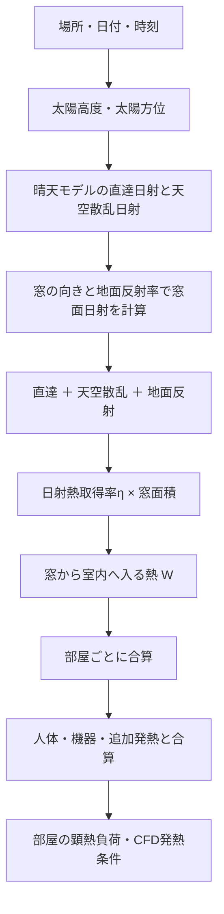
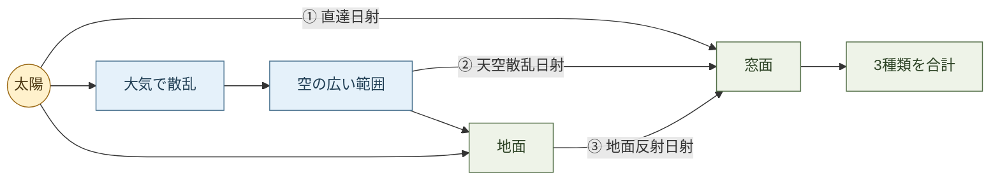
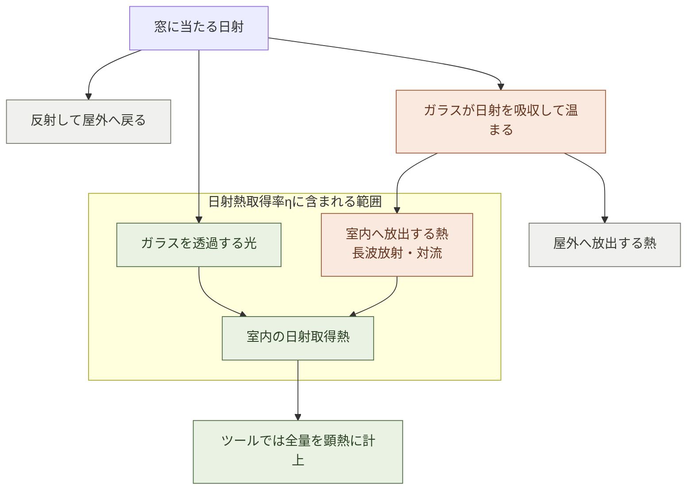
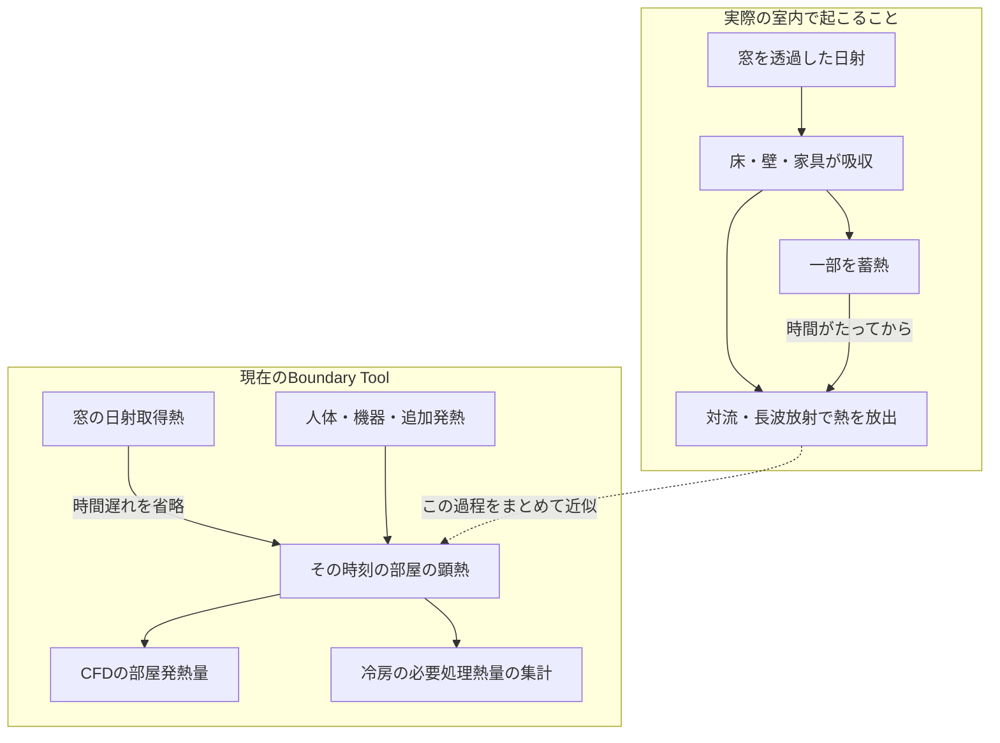

# Boundary Tool｜日射計算のしくみ

**窓に当たる「直達・天空散乱・地面反射」の日射を合計し、日射熱取得率ηと窓面積を掛けて、部屋に入る熱量を求めます。** ガラスが吸収した日射から室内へ放出する熱もηに含め、取得した熱は全量を部屋の顕熱負荷へ加えます。

- **対象:** 2026年10月27日時点のBoundary Tool実装。
- **主な範囲:** 窓の日射熱取得から、部屋の発熱量・冷房負荷へ渡すまで。
- **計算の位置付け:** 鉛直窓を対象にした簡易計算。室内表面の温度や蓄熱を追う動的な放射計算ではありません。

> [!IMPORTANT] 「再放射を含める」の意味
> ガラスが日射を吸収して室内へ放出する熱を、日射熱取得率ηにまとめて含めます。ガラス温度を計算して、長波放射と対流を別々に求めているわけではありません。
> 透過した日射が床・家具に吸収された後の熱も、時間遅れを設けず、その時刻の顕熱負荷として計上します。

## 1. 計算の流れ



> [!NOTE] EnergyPlus連携の分岐
> 利用できるSQLの窓日射データがある場合は、晴天モデルだけで計算せず、SQLの値を使用・補完します。詳細は「6. EnergyPlus連携」を参照してください。

## 2. 窓に当たる3種類の日射

**窓が太陽の反対側を向いていても、天空散乱日射と地面反射日射は入ります。**



> [!TIP] 窓の裏側でもゼロにならない理由
> 太陽からの直接の矢印が届かなくても、空や地面からの矢印は残ります。これが、直達だけの旧方式との大きな違いです。

| 種類 | イメージ | 現在の計算 |
| :--- | :--- | :--- |
| 直達日射 | 太陽から直接届く光 | 太陽高度・方位と窓の向きで入射角を補正 |
| 天空散乱日射 | 空から広く届く光 | 空を均一な明るさとする等方天空モデル |
| 地面反射日射 | 地面に当たって跳ね返る光 | 水平面全天日射×地面反射率で計算 |

### 入力と記号

| 記号 | 意味 | 単位・設定 |
| :--- | :--- | :--- |
| `h` | 太陽高度 | 計算から取得 |
| `Az` | 太陽方位 | 南0°、東−90°、西90° |
| `wAz` | 窓の方位 | 太陽方位と同じ基準 |
| `DNI` | 法線面直達日射。コードの`idn` | W/m² |
| `DHI` | 水平面天空散乱日射。コードの`isky` | W/m² |
| `GHI` | 水平面全天日射 | W/m² |
| `ρ` | 地面反射率 | 0〜1 |
| `η` | 窓の日射熱取得率。画面の`η0` | 0〜1 |
| `A` | 窓面積 | m² |

### 晴天モデル

太陽が地平線より上にあるとき、次の近似を使います。

```text
DNI = 1098 × exp(−0.057 / sin h)
DHI = 0.125 × DNI
GHI = DNI × sin h ＋ DHI
```

- **太陽位置:** 緯度・経度・日付・時刻から算出します。時刻の補正は日本標準時の基準経度135°を使用します。
- **夜間:** 晴天モデルでは太陽高度が0以下なら、3種類の日射をすべて0にします。
- **天候:** `DHI = 0.125 × DNI`は固定の簡易近似で、曇天や実測気象を表すものではありません。

### 鉛直窓に当たる日射

```text
cosθ = cos h × cos(Az − wAz)

窓面直達日射     = DNI × max(cosθ, 0)
窓面天空散乱日射 = DHI × 0.5
窓面地面反射日射 = GHI × ρ × 0.5

窓面合計日射 I = 窓面直達 ＋ 窓面天空散乱 ＋ 窓面地面反射
```

- **0.5の意味:** 遮る物のない鉛直面について、天空側と地面側の幾何学的な割合を、それぞれ1/2としています。
- **裏向きの窓:** 直達日射だけを0にし、散乱・地面反射分は残します。
- **対象外:** 近隣の壁からの反射、庇・樹木・周辺建物による遮蔽を、この晴天近似では計算しません。

## 3. 透過日射とガラスからの再放射

**ηは光の透過率そのものではなく、「最終的に室内へ入る日射由来の熱」の割合です。**

### 図解：窓に当たった日射はどこへ行くか



- **室内へ入る分:** 透過分とガラス吸収後の室内流入分を合わせます。
- **屋外へ戻る分:** 反射・屋外への放熱は、室内の日射取得熱には加えません。
- **図の位置付け:** 熱の行き先を説明した概念図です。現在のツールは各矢印の熱量を個別に解かず、ηでまとめて計算します。

```text
日射熱取得率η
  ＝ 日射の透過分
   ＋ ガラスなどが吸収した日射のうち、室内へ流入する分
```

| 現象 | 現在の扱い |
| :--- | :--- |
| 光が窓を透過して室内へ入る | ηに含める |
| ガラスが温まり、放射・対流で室内へ熱を渡す | ηに含める。両者の内訳は分離しない |
| 透過した光が床・家具に吸収され、後で熱を放出する | 時間遅れを省き、取得した熱をその時刻の顕熱に全量計上 |
| 室内外の温度差による窓の熱移動 | U値・表面熱伝達率などによる別系統の窓境界条件 |

窓1枚から室内へ入る日射熱は、次の式です。

```text
Q_window [W] = I [W/m²] × η [−] × A [m²]
```

> [!WARNING] 再放射の二重計上を避ける
> `I × η × A`に、さらに「ガラスの再放射分」を上乗せしてはいけません。ηに含まれる室内流入を重複して計上するためです。
> また、可視光透過率や日射透過率を、そのままηの欄へ入力することは想定していません。

## 4. 数値例

**中間値の例として、DNIを800W/m²と仮定します。** 太陽高度30°・太陽と同じ方位の鉛直窓、地面反射率0.2、η=0.5、窓面積2m²とします。これは計算を追うための例で、前述の晴天式からDNIを算出した事例ではありません。

| 計算項目 | 計算 | 結果 |
| :--- | :--- | ---: |
| 水平面天空散乱DHI | 800×0.125 | 100 W/m² |
| 水平面全天GHI | 800×sin30°＋100 | 500 W/m² |
| 窓面直達 | 800×cos30° | 約692.8 W/m² |
| 窓面天空散乱 | 100×0.5 | 50 W/m² |
| 窓面地面反射 | 500×0.2×0.5 | 50 W/m² |
| 窓面合計 | 692.8＋50＋50 | 約792.8 W/m² |
| 室内日射熱 | 792.8×0.5×2 | **約792.8 W** |

同条件で窓を太陽の反対側へ向けると、直達は0になりますが、散乱・反射分から **100W** の室内日射熱が残ります。

## 5. 部屋の発熱量・冷房負荷への集計

**各窓の日射熱を部屋ごとに合算し、人体・機器などの顕熱と足します。**

### 図解：実際の熱の流れと、ツールでの簡略化



> [!WARNING] 時間遅れを省くことの意味
> 日射が入っている時刻に熱をまとめて計上します。日射がなくなった後も床や家具から熱が出る現象は追えません。「全量計上」でも、夕方・夜間の負荷まで常に安全側になるわけではありません。

```text
部屋の窓日射熱 = その部屋に属する各窓の Q_window の合計

部屋の顕熱 = 窓日射熱 ＋ 人体顕熱 ＋ 機器顕熱 ＋ 追加顕熱
```

- **CFD:** 部屋の発生エリアに渡す発熱量へ反映します。日射の当たる床面へ局所的に熱を与える計算ではありません。
- **冷房負荷:** この顕熱集計が後段の必要処理熱量の計算へ使われます。建物全体の冷房負荷は、窓日射熱だけで決まりません。
- **潜熱:** 日射熱を発湿量・潜熱へは加えません。

### 旧方式との違い

| 項目 | 旧方式 | 現在 |
| :--- | :--- | :--- |
| 通常ルートの窓面日射 | 直達のみ | 直達＋天空散乱＋地面反射 |
| 日射取得後の補正 | `f_c＋(1−f_c)×r_G`を掛ける | 減額せず全量計上 |
| ガラス吸収後の室内流入 | ηと透過率の説明が混在 | ηに含まれるものとして明示 |
| 室内の蓄熱・時間遅れ | 固定係数による減額。熱の持越しなし | 持越しを省略し、取得熱を即時計上 |

> [!NOTE] 古い設定・関数
> 互換性のため旧`solarFc`入力や`r_G`関連関数がコードに残っていますが、現在の部屋の日射熱集計では使いません。

## 6. EnergyPlus連携

### 多層ガラスのη推定（2026年10月27日修正）

**旧式の「各ガラスの透過率の積×0.87」は使用しません。** `SimpleGlazingSystem`にSHGCが指定されている場合は、その値を使用します。

1. **光の計算:** 各層の垂直入射日射透過率・表裏の日射反射率から、層間の多重反射を含めた全体の透過率と、各層の吸収量を計算します。
2. **熱の分配:** ガラス・ガス層・内外表面の熱抵抗から、各層の吸収熱が室内へ流れる割合を推定します。吸収位置は各ガラスの厚み中央とします。
3. **取得率の合算:** `η = 全体の透過率 ＋ Σ（各層の吸収率 × 室内流入割合）`とします。

> [!NOTE] 定常・垂直入射の簡易推定
> 室内流入割合は「屋外から吸収位置までの熱抵抗÷全熱抵抗」です。表面熱伝達率は室外23、室内9 W/m²K、ガス層は既存の簡易熱抵抗モデルを使用します。規格に基づく認証SHGCやEnergyPlusの詳細熱収支計算と同一ではありません。メーカーの仕様値を優先してください。

- **推定する構成:** 必要な物性がそろった`SpectralAverage`のガラスと、対応する単一ガス層。
- **推定しない構成:** スペクトル指定、ブラインド・シェード、混合ガス、汚れ補正が1以外、物性不足・不整合など。ηを空欄にし、仕様値の入力を促します。
- **従来の仮値:** 推定できない場合にηを0.54で自動補完する処理も廃止しました。

### SQLの日射熱の利用

**SQLの透過日射を優先し、日射熱取得率ηから推定した総取得熱との差を、ガラス吸収後の室内流入の概算として補います。**

```text
Q_SHGC = 窓面入射日射 × η × 窓面積
Q_abs,in = max(Q_SHGC − Q_transmitted, 0)
Q_window = Q_transmitted ＋ Q_abs,in
         = max(Q_transmitted, Q_SHGC)
```

| データの状態 | 処理 |
| :--- | :--- |
| 対象窓・時刻の透過日射と面日射あり | 透過日射を使用し、面日射×η×面積との差分を補う |
| 透過日射あり、面日射なし | 面日射を晴天近似で補い、同じ差分計算を行う |
| 透過日射なし、面日射を利用できる | 面日射×η×面積で計算 |
| 利用できるSQL日射なし | 通常の晴天近似へ戻る |

- **照合:** 窓名と対象日時でSQLの系列を検索します。透過日射がW/m²なら窓面積を掛けます。
- **現在の呼出条件:** `energyplus`モードで、SQLに透過日射系列が1つ以上ある場合に、透過・面日射の検索を行います。SQLに面日射しかない場合、現在の部屋集計は晴天近似へ戻ります。
- **二重加算防止:** SQLの透過日射へ、晴天モデルの散乱・反射分をそのまま足しません。
- **ゼロの扱い:** SQLの面日射・透過日射がともに0なら0として扱い、晴天値で上書きしません。

> [!WARNING] 差分はガラス熱収支の厳密解ではありません
> `面日射×η×面積−透過日射`は、一定のηを使った簡易推定です。入射角・遮蔽物・窓仕様などの条件差を含むため、実際の再放射量と一致するとは限りません。
> 特に面日射がない場合の晴天補完は、EnergyPlusで計算された庇などの遮蔽を再現せず、熱量を大きく見積もる場合があります。

## 7. この計算で分かること・分からないこと

| 項目 | 対応 |
| :--- | :--- |
| 北向き窓などの散乱・反射による日射取得 | 簡易計算できる |
| 窓から室内へ入る日射由来の総熱量 | ηによる概算ができる |
| 日射熱の部屋別合計・顕熱への反映 | 対応 |
| ガラスの温度・長波放射量・対流量の分離 | 未対応 |
| 床・家具ごとの日射吸収分布 | 未対応 |
| 蓄熱した熱の夕方・夜間への持越し | 未対応 |
| 天候変化・周辺遮蔽・周辺建物からの反射 | 晴天近似では未対応 |
| あらゆる条件で安全側となるピーク冷房負荷 | 保証しない |

> [!TIP] 結果を見るときの確認点
> 窓のη・面積・方位、敷地の緯度経度、日時、地面反射率を確認してください。散乱・反射の追加と旧係数の減額廃止により、従来の過小評価要因は減ります。ただし、夜間に残る蓄熱負荷などは別途考慮が必要です。

## 8. 実装と参考資料

| ファイル・関数 | 役割 |
| :--- | :--- |
| `js/02-solar.js` / `solarPos` | 太陽位置 |
| `js/15-sat-etd.js` / `windowSolarGain` | 直達・散乱・反射、ηによる取得熱、SQL差分補完 |
| `js/15-sat-etd.js` / `epTransmittedW` | SQL透過日射の参照・単位換算 |
| `js/06-run-all.js` / `runAll` | 晴天日射の計算、窓別計算の呼出し、部屋別顕熱への合算 |
| `tests/window-solar-gain.cjs` | 方位・夜間・反射率・SQL差分・二重加算防止の確認 |
| `tests/workspace-browser.cjs` | 部屋の顕熱への反映、旧`f_c`設定に依存しないことの確認 |

- **窓の吸収・透過の考え方:** [EnergyPlus — Window Calculation Module](https://energyplus.readthedocs.io/en/stable/guides/engineering-reference/7.7-window-calculation-module.html)。ツールのSQL差分式自体は、本ツール独自の簡易近似です。
- **天空散乱のモデル:** [pvlib — get_sky_diffuse](https://pvlib-python.readthedocs.io/en/stable/reference/generated/pvlib.irradiance.get_sky_diffuse.html)。本ツールでは等方天空の簡易式を使用しています。
